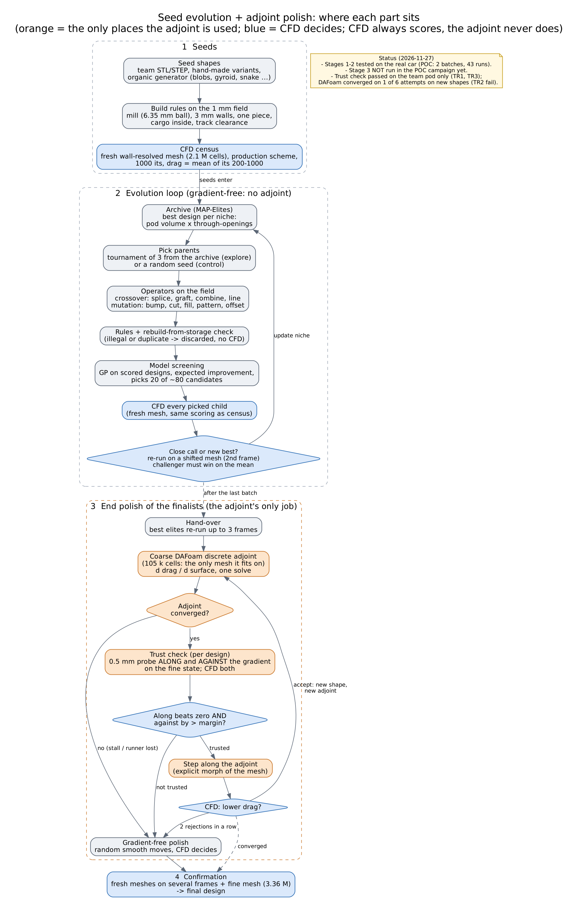

# Seed evolution: what it is, how it fits together, and where it stands (2026-11-27)

The sidepod of the STEM Racing car is designed by **evolving whole shapes** (gradient-free, topology can change) and
**polishing the finalists with an adjoint** that CFD has first checked. Every number that decides anything comes from
a CFD run; the adjoint only proposes directions. Flowchart: [`flowchart/seedevo_flow.png`](flowchart/seedevo_flow.png)
(source `flowchart/seedevo_flow.dot`). Pass marks: `SEED_EVOLUTION_PLAN.md` (each fixed before its run). Every verdict
and number: `SEED_EVOLUTION_RESULTS.md`. Go/no-go summary: `GO_NO_GO.md`.

## 1. The design and the rules

- A design is a **field on a 1 mm grid** (`space.py`, `RealSpace`): mm, positive = foam, inside the sidepod region
  (x 50-159 mm, |y| 0.5-32.5 mm, z 2.5-39.5 mm of the car frame). Outside the region the car is fixed (nose, body,
  halo, wheels, cartridge).
- `space.build()` applies the **rules** (from `shape_loop.build_design`): milled with a 6.35 mm ball, 3 mm minimum
  walls, one piece, cargo inside, track clearance, forced-air zone. Anything illegal is dropped before CFD.
- Designs are described by **pod volume** and **through-openings**; these are the archive's niche axes
  (volume bins 20/40/55/70/90 cm3 x openings 0 / 1 / 2-3 / 4+).

## 2. The parts (files)

| Part | File | Job |
|---|---|---|
| Seeds | `ingest.py`, `seed_gen.py`, `designs/`, `organic_seeds/` | STL/STEP or generated seeds -> fields. `seed_gen.py` makes organic seeds (blobs, lumpy, gyroid, snake, teardrop, cppn, worley) |
| Operators | `operators.py` | crossover: splice, graft, combine, line; mutation: bump, cut, fill, pattern, offset (random parameters, see section 6) |
| Archive + driver | `campaign.py` | MAP-Elites archive, parent tournament, duels and re-runs, batch writing, setup offsets, `max_gen` stop, storage check |
| Model screening | `screen.py` | Gaussian process + expected improvement + kriging believer on block-occupancy features: picks 20 of ~80 candidates (from the evolution branch's layout search) |
| CFD case | `campaign_case.py` | on a runner: rebuild the design from its stored field, fresh wall-resolved mesh, production scheme, write `case_<id>_k<k>.json` |
| Adjoint probes | `probe_step.py`, `tr_predict.py`, `gate_verdict.py` | morph a fine steady state along / against a gradient; DAFoam first-order prediction; trust verdicts |
| Bench engine | `engine.py`, `toy.py`, `run_*.py` | the same algorithm on a toy problem with known answers (tests T3, TF, TS, TC) |
| Renders | `render_fields.py`, `campaign_*/renders/` | images of built designs |

## 3. The stack

- **CFD:** OpenFOAM v2412 (openfoam.com), RANS k-omega SST, half car with a symmetry plane. Scoring mesh: fresh
  snappyHexMesh per design, about **2.1 M cells**, wall-resolved (11 layers, ratio 1.3; layers on ~60 % of the wall;
  surface level 5). **Production scheme (linearUpwind), 1000 iterations; drag = mean of iterations 200-1000.**
  Meshing frame k shifts the domain by k x 0.37 mm (re-runs use a new frame).
- **Adjoint:** DAFoam v5.1.1 (Docker), discrete adjoint, Krylov GMRES, on the **coarse 105 k-cell mesh** only
  (memory). The ESI OpenFOAM continuous adjoint was tested and failed its bump tests; it is not used.
- **Compute:** GitHub Actions (public repository: standard runners are free; 4 cores, ~16 GB; up to 20 jobs at once).
  Workflows: `seedevo_campaign.yml` (one batch per run; auto mode hands over to the next batch), `seedevo_gate.yml`
  and `seedevo_gate_retry.yml` (noise and trust tests). OpenFOAM installs from checksum-pinned packages
  (`.github/scripts/install_openfoam.sh`).
- **Driver side:** Python 3.11-3.13, numpy, scipy, scikit-learn, trimesh, scikit-image, pymeshlab.

## 4. The process (one campaign)

1. **Seeds -> census.** Each seed is built under the rules and scored once by CFD.
2. **Evolution batches** (gradient-free, no adjoint): parents from the archive (tournament of 3) or a random seed
   (control), operators make children, the rules and a rebuild-from-storage check drop bad ones, model screening picks
   the batch, CFD scores every child on a fresh mesh. Close calls and new bests are re-run on a second meshing
   frame; a challenger takes a niche only on the mean. Repeat to `max_gen`.
3. **Hand-over:** the best elites are re-run up to 3 frames.
4. **End polish (the adjoint's only job)**, finalists only: coarse DAFoam gradient -> if converged, the **trust check**
   (0.5 mm probe along and against the gradient on the fine steady state, CFD both) -> if trusted, steps along the
   adjoint, each accepted or rejected by CFD, a new gradient after each accepted step; 2 rejections in a row, no
   convergence, or no trust -> gradient-free polish (random smooth moves, CFD decides).
5. **Confirmation:** fresh meshes on several frames, then the fine mesh (3.36 M cells).

**Cost per design:** a child in evolution costs **one CFD run** (two if it is a close call). Only the 2-3 finalists
cost adjoints: one gradient per accepted step plus two trust probes. Most of a campaign is single forward runs.

## 5. Why the adjoint sits only at the end, and what backs it

- Evolution handles big, topology-changing moves; the adjoint gives a direction for every surface point at the cost
  of about one extra solve, but only for small local changes. On the bench, adjoint polish after evolution beat the
  adjoint inside the loop (T3b), and a useless or misleading adjoint inside the loop cost real performance (T3c fail).
- **Evidence on the real car (team pod):** trust check: along the gradient -2.64 mN, against it +3.39 mN, two random
  moves of the same size +0.03 / -0.30 mN (TR1, TR3 pass). Earlier hybrid loop: adjoint steps confirmed under the
  production scheme at -6.3, -8.2 and -9.1 mN.
- **Limits (stated, not hidden):** the coarse gradient overstates the gain about 2.5x (predicted -7.5 mN, measured
  -2.6), so step sizes are set by CFD, never by the adjoint. On shapes unlike the team pod DAFoam converged on 1 of 6
  attempts (one stall, runners lost to memory with 4 ranks; with 2 ranks the runner survives but a shorter GMRES
  restart stalls), so TR2 failed for lack of a gradient: those shapes are polished gradient-free.
- **Framing:** a low-fidelity gradient used as a proposal under high-fidelity verification, with an explicit trust test
  before use, as in multi-fidelity trust-region model management (Alexandrov et al., 1998). The claim it supports:
  near the team pod the coarse adjoint gives a direction that CFD confirms and that beats random moves; not yet shown
  for shapes far from it.

## 6. What can be tuned

| Group | Setting (current) |
|---|---|
| Breeding | `n_explore` 16, `n_control` 4, tournament 3, crossover share 50 %, operator list (all 9), niche bins, `max_gen`, `every_seed_once` |
| Mutation sizes | bump 2-6 mm high, 8-20 mm wide; offset 0.5-2 mm in or out; cut/window radius 3.2-7 mm; pattern pitch 6-14 mm; regions 10-35 mm |
| Screening | on/off, `screen_pool` 4, `screen_min` 12, GP features (8 shape components + volume, Matern kernel) |
| Re-runs | `duel_se` 0, `duel_min_runs` 2, `max_runs` 3, `handover_top` 12 |
| Polish | step 0.5 mm, trust check on, `stop_after` 2, gradient-free method random (CMA-ES failed its test), `gf_proposals` 2, `floor` 0 |
| CFD (fixed by tests) | 2.1 M-cell mesh, production scheme 1000 its, score on its 200-1000; score = drag (race time is the planned alternative) |

## 7. Where it stands

| Test | Result |
|---|---|
| T0 / T0b seeds and operators | pass |
| TP plumbing (coarse CFD) | pass |
| Bench T3a, TFb, TFc, TS | pass; T3b, T3c, T3e', TFa, TC2 fail (the adjoint goes at the end; evolution beats the reference on average, not on every seed) |
| TW campaign workflow | pass |
| T1 noise | wall layers pass; production sigma 0.57 mN (one run scores a design); steady model 1.42 mN |
| TR trust check | TR1, TR3 pass (team pod); TR2 fail (no gradient on new shapes) |
| POC campaign (4 seeds, 2 batches, 43 runs) | P1 fail (batch-1 hand-over needed a manual step; batch 2 ran unattended), P2 pass; d7 -2.72 mN and d10 -2.09 mN below the best seed on two frames each |
| Approval test (team pod + 14 organic seeds) | running: census, 3 batches, confirmation; mark A1: best design beats its own seed by >= 1.4 mN and >= 2 % |

Known gaps: scoring is drag only (d7 is 1.5 g over the ballast target, which race-time scoring would penalise); one
scoring mesh size so far (fine-mesh confirmation still to run); the milling ball and wall rules close fine openings,
so generated lattices come out solid.
